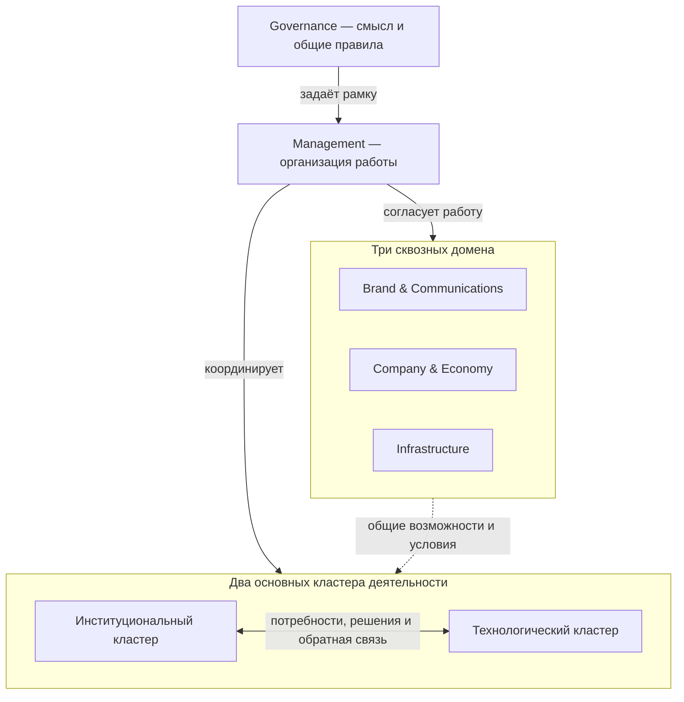

# Экосистема DETai

**Ecosystem DETai** — экосистема, объединяющая метод
диалектической экзистенциальной терапии (DET), исследования, образование,
профессиональное сообщество и AI-инструменты. Общий смысл и направление её развития
раскрывает [наша миссия](../governance/mission.md).

**DET** — Dialectical Existential Therapy, диалектическая экзистенциальная терапия:
самостоятельный психотерапевтический метод и методологическое ядро Ecosystem DETai.
Его профессиональная жизнь охватывает применение, передачу и исследование метода.
DET может применяться в психотерапии, а его идеи и практики — передаваться через
образовательные программы и мероприятия специалистам и людям, заинтересованным
в самопознании и развитии. В исследованиях могут проверяться его теоретические
положения и результаты применения, уточняться и развиваться его научное обоснование.
Эти три контура — психотерапия, образование и исследования — образуют институциональное направление экосистемы.

**DETai** добавляет к этому институциональному направлению связанное технологическое
направление. **DETai** воплощает концепцию AI-усиленной психотерапии и расширяет
возможности DET в практике, образовании, исследовании и управлении знаниями.

Таким образом, Ecosystem DETai объединяет два взаимосвязанных направления — институциональное
и технологическое. Эти два направления деятельности организованы в кластеры:

**Institutional Cluster** — участники и направления деятельности, которые поддерживают
профессиональную жизнь метода в психотерапии, образовании и исследованиях.

**Technology Cluster** — проекты, которые создают цифровые продукты, поддерживают
и развивают связанную цифровую среду всей экосистемы.

Общие управление, бренд, экономика и инфраструктура связывают их в одно целое.

Эта страница показывает общую картину: назначение крупных частей и связи между
ними. Подробное устройство каждой части раскрывается на её странице.

## Карта экосистемы {#геометрия-целого}

Стрелки показывают разные отношения: общую рамку, координацию, сотрудничество
и обеспечение. Сквозные домены работают для обоих кластеров и для управления.
Схема описывает распределение функций и ответственности; один участник может
совмещать несколько ролей.

## Два кластера — два основных направления деятельности {#два-слоя-одного-целого}

**Кластер — крупное объединение связанных направлений деятельности, людей
и проектов внутри экосистемы.**

### Институциональный кластер {#институциональный-слой}

Институциональный кластер объединяет участников трёх контуров:
**психотерапии, образования и исследований**. Супервизия относится
к психотерапевтическому контуру. Здесь DET может применяться в практике,
его идеи и практики — передаваться специалистам и людям, заинтересованным
в самопознании и развитии, а теоретические положения и результаты применения —
проверяться в исследованиях.

[Устройство институционального кластера](../institutional-layer/index.md)
объясняет эти связи и значение слова «институциональный».

### Технологический кластер {#технологический-слой}

Технологический кластер объединяет команды и проекты, которые создают,
поддерживают и развивают **DETai — связанную цифровую среду всей экосистемы**.
Его решения воплощают концепцию **AI-усиленной психотерапии**, расширяют
возможности DET в практике, образовании, исследовании и управлении знаниями,
а также поддерживают другие направления деятельности экосистемы.

[Устройство технологического кластера](../technology/index.md)
раскрывает создание решений и доставку работающих версий.

## Общее управление {#управление}

| Направление | За что отвечает |
|---|---|
| [**Governance**](../governance/index.md) | Миссия, видение, ценности, общие границы и правила полномочий |
| [**Management**](../management-layer/index.md) | Стратегия, приоритеты, роли, ресурсы и координация совместной работы |

Governance задаёт рамку общего действия. Management организует работу в этой
рамке и помогает согласовать вопросы, затрагивающие разные области ответственности.

## Три сквозных домена {#сквозные-системы}

**Домен — область ответственности за определённые вопросы, результаты
и решения.** Домен может находиться внутри кластера или работать поперёк обоих.

| Домен | Что связывает и обеспечивает |
|---|---|
| [**Brand & Communications**](../brand-and-communications/index.md) | Общий бренд, визуальный язык, понятное представление предложений и связь с аудиторией |
| [**Company & Economy**](../company-and-economy/index.md) | Экономические и корпоративные условия: цены, затраты, доходы, договоры, права и устойчивость деятельности |
| [**Infrastructure**](../infrastructure/index.md) | Общие системы, знания, данные и среды, необходимые для работы экосистемы |

Профессиональное содержание, устройство цифрового решения, его публичное
представление и экономические условия имеют разные области ответственности.
Они согласуются в работе над одним результатом.

## Метод DET и роль AI {#ai-усиленная-психотерапия}

[**DET — диалектическая экзистенциальная терапия**](../institutional-layer/det/index.md)
— самостоятельный психотерапевтический метод и методологическое ядро Ecosystem DETai.
Экосистема объединяет метод, исследования, образование, профессиональное сообщество
и AI-инструменты в общую среду.

[**AI-усиленная психотерапия**](https://detai-x.com/ru/ai-augmented-psychotherapy) —
общая концепция: AI и цифровая среда расширяют возможности психотерапевтического
метода, опираясь на его теорию. Она охватывает работу психотерапевта,
терапевтический процесс, развитие метода и профессиональную память.
В Ecosystem DETai эта концепция применяется к DET и воплощается в решениях
технологического кластера. Живая встреча сохраняет центральное значение.
Люди определяют цели, профессиональные границы и значимые решения. AI помогает
исследовать, структурировать знания и создавать решения; развитие технологии
и развитие метода требуют своих процедур проверки.

## Когда проекты становятся экосистемой {#когда-проекты-становятся-экосистемой}

Отдельные проекты образуют экосистему, когда используют общие основания
и возможности, переиспользуют результаты друг друга и возвращают целому ресурсы
для следующего развития. Общий бренд делает эту связь узнаваемой для людей,
а управление помогает сохранять согласованность действий.

## Инструменты и участие

[**Tools**](../tools/index.md) — справочник средств работы и руководств по ним.
[**Onboarding**](../onboarding/index.md) — маршрут от знакомства с экосистемой
к осмысленному участию; его проектирование и сопровождение относятся к Management.

Эти разделы помогают работать и входить в работу. Их отдельное положение
в меню объясняется задачами читателя и не добавляет кластеров или сквозных доменов
к карте экосистемы. Значения общих терминов собраны в [глоссарии](../knowledge/glossary.md).
