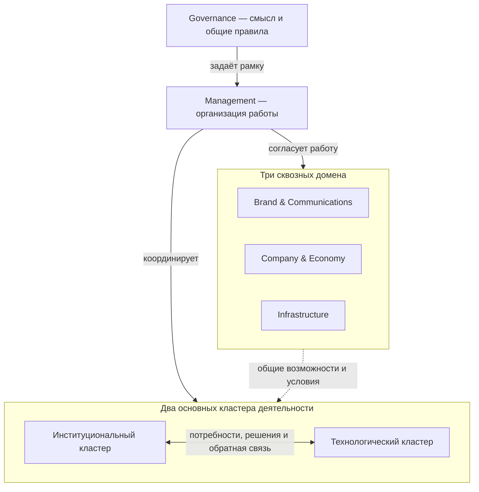

# Экосистема DETai

**DETai — экосистема вокруг психотерапевтического метода DET, объединяющая
психотерапию, образование, исследование и цифровые решения.** У неё два основных
направления деятельности — институциональный и технологический кластеры. Общие
управление, бренд, экономика и инфраструктура связывают их в одно целое.

Эта страница показывает общую картину: назначение крупных частей и связи между
ними. Подробное устройство каждой части раскрывается на её странице.

## Карта экосистемы {#геометрия-целого}

Стрелки показывают разные отношения: общую рамку, координацию, сотрудничество
и обеспечение. Сквозные домены работают для обоих кластеров и для управления.
Схема описывает распределение функций и ответственности; один участник может
совмещать несколько ролей.

## Два кластера — два основных направления деятельности {#два-слоя-одного-целого}

**Кластер — крупное объединение связанных направлений деятельности, людей
и проектов внутри DETai.**

### Институциональный кластер {#институциональный-слой}

Профессиональная жизнь метода: **психотерапия и супервизия, образование,
исследование**. Здесь метод применяется, передаётся специалистам, обсуждается
и развивается с профессиональной ответственностью.

[Устройство институционального кластера](../institutional-layer/index.md)
объясняет эти связи и значение слова «институциональный».

### Технологический кластер {#технологический-слой}

Создание, развитие и работа цифровых продуктов и сервисов. Здесь люди и AI
разрабатывают решения, которые расширяют возможности участников, специалистов
и пользователей экосистемы.

[Устройство технологического кластера](../technology/index.md)
раскрывает создание решений и доставку работающих версий.

## Общее управление {#управление}

| Направление | За что отвечает |
|---|---|
| [**Governance**](../governance/index.md) | Миссия, видение, ценности, общие границы и правила полномочий |
| [**Management**](../management-layer/index.md) | Стратегия, приоритеты, роли, ресурсы и координация совместной работы |

Governance задаёт рамку общего действия. Management организует работу в этой
рамке и помогает согласовать вопросы, затрагивающие разные области ответственности.

## Три сквозных домена {#сквозные-системы}

**Домен — область ответственности за определённые вопросы, результаты
и решения.** Домен может находиться внутри кластера или работать поперёк обоих.

| Домен | Что связывает и обеспечивает |
|---|---|
| [**Brand & Communications**](../brand-and-communications/index.md) | Общий бренд, визуальный язык, понятное представление предложений и связь с аудиторией |
| [**Company & Economy**](../company-and-economy/index.md) | Экономические и корпоративные условия: цены, затраты, доходы, договоры, права и устойчивость деятельности |
| [**Infrastructure**](../infrastructure/index.md) | Общие системы, знания, данные и среды, необходимые для работы экосистемы |

Профессиональное содержание, устройство цифрового решения, его публичное
представление и экономические условия имеют разные области ответственности.
Они согласуются в работе над одним результатом.

## Метод DET и роль AI {#ai-усиленная-психотерапия}

[**DET — диалектическая экзистенциальная терапия**](../institutional-layer/det/index.md)
— авторский психотерапевтический метод внутри экзистенциально-гуманистического
подхода и методологическое ядро DETai. Сам метод, его профессиональная жизнь
и вся экосистема — связанные понятия разного масштаба.

**AI-усиленная психотерапия** здесь означает развитие профессиональной жизни
метода с помощью цифровых возможностей и ответственной обратной связи.
Люди определяют цели, профессиональные границы и значимые решения. AI помогает
исследовать, структурировать знания и создавать решения; развитие технологии
и развитие метода требуют своих процедур проверки.

## Как работа возвращается в развитие {#два-слоя-и-общий-бренд}

Кластеры создают цифровые продукты и профессиональные форматы — например,
приложение или образовательную программу. Работа с аудиторией, дизайном,
ценностью и экономическими условиями начинается при подготовке предложения
и продолжается после его запуска.

Пользовательский опыт, обратная связь, знания, доверие и финансовые результаты
помогают выбрать следующее улучшение. Следующий цикл уточняет содержание,
реализацию, представление или условия предложения. Публичный выпуск — важная
точка готовности внутри этого повторяющегося процесса.

Подробности взаимодействия описаны в
[цикле создания и развития предложений](../brand-and-communications/product-market-cycle.md).

## Когда проекты становятся экосистемой {#когда-проекты-становятся-экосистемой}

Отдельные проекты образуют экосистему, когда используют общие основания
и возможности, переиспользуют результаты друг друга и возвращают целому ресурсы
для следующего развития. Общий бренд делает эту связь узнаваемой для людей,
а управление помогает сохранять согласованность действий.

## Инструменты и участие

[**Tools**](../tools/index.md) — справочник средств работы и руководств по ним.
[**Onboarding**](../onboarding/index.md) — маршрут от знакомства с экосистемой
к осмысленному участию; его проектирование и сопровождение относятся к Management.

Эти разделы помогают работать и входить в работу. Их отдельное положение
в меню объясняется задачами читателя и не добавляет кластеров или сквозных доменов
к карте экосистемы. Значения общих терминов собраны в [глоссарии](../knowledge/glossary.md).
